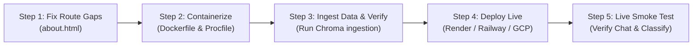

# 📊 MedIntel AI — Project Status, Completed Work & Deployment Roadmap

**Date:** September 2, 2026  
**Project:** MedIntel AI — Regulatory Intelligence Platform for African Healthcare  
**Target:** Rapid Deployment (MVP to Production)

---

## 🧭 Executive Summary

MedIntel AI is positioned as the **first AI-powered regulatory intelligence platform purpose-built for Nigerian (NAFDAC) and African medical device and pharmaceutical compliance**. 

The core functional MVP codebase is **~85% complete**. The backend API architecture, RAG engine, built-in regulatory knowledge base, device classification system, interactive compliance workflows, and multi-page frontend UI are fully designed and implemented.

The immediate priority is **resolving minor frontend loose ends, validating knowledge base persistence, containerizing the app, and executing the live deployment**.

---

## 1. ✅ What Has Been Implemented (Completed Work)

### 🔹 Backend & API Architecture (FastAPI)
- **FastAPI Application Core** (`app/main.py`):
  - Async REST API with modular routers (`/api/chat`, `/api/checklists`, `/api/classify`).
  - CORS middleware configured for cross-origin integration.
  - Static file mounting and Jinja2 templating for server-rendered UI.
  - Health check endpoint (`/health`) for deployment uptime monitoring.
- **Centralized Configuration** (`app/config.py`):
  - Environment-based configuration with `pydantic-settings`.
  - Configurable LLM model (`gemini-1.5-flash`), embedding model (`text-embedding-004`), chunk sizes, overlap, and Chroma persist paths.

### 🔹 Intelligence & RAG Engine (`app/services/rag_engine.py`)
- **LangChain + Google Gemini Integration**:
  - `ChatGoogleGenerativeAI` integration for natural language generation.
  - `GoogleGenerativeAIEmbeddings` for vector embeddings.
  - NAFDAC/African regulatory prioritization prompt with mandatory citation enforcement and safety disclaimers.
- **ChromaDB Vector Store**:
  - Local vector database integration with persistent storage.
  - Similarity retriever with metadata filtering and source snippet extraction.
- **AI Medical Device Classifier**:
  - Risk-based classification logic aligned with NAFDAC 2025 regulations (Classes A, B, C, D) and IMDRF SaMD frameworks.
  - Returns classification tier, justification, regulatory pathway, required testing/documents, and estimated timelines.

### 🔹 Compliance Workflows & Curated Content (`app/api/checklists.py`)
- **Interactive Regulatory Checklists**:
  1. **NAFDAC Drug Product Registration** (6 steps: Pre-Registration, CAC & Premises Licensing, CTD Dossier Modules 1–5, NAPAMS Submission, Lab Evaluation, Post-Market).
  2. **NAFDAC Medical Device Registration** (6 steps: Risk Classification, ISO 13485 QMS, Technical File/IEC 62304/ISO 14971, NAPAMS Submission, Regulatory Review, Post-Market Surveillance).
  3. **NAFDAC IVD Registration** (3 steps: Risk Classification, Analytical/Clinical Performance Evaluation, Dossier Submission).
  4. **WHO GMP Compliance** (4 steps: Gap Analysis, Facility Qualification DQ/IQ/OQ/PQ, QMS Implementation, Process Validation).

### 🔹 Data Ingestion Pipeline (`app/ingest.py`)
- Automated ingestion pipeline supporting PDF, Markdown, and TXT parsing.
- Text chunking (`RecursiveCharacterTextSplitter`) with overlap to preserve regulatory context.
- **Built-in Regulatory Knowledge Base**: Deeply curated fallback corpus covering the NAFDAC Act, Medical Devices Regulations 2025, SaMD/AI guidelines, and CTD dossier requirements.

### 🔹 Frontend & User Interface (`templates/` & `static/`)
- **Modern Responsive Web UI**:
  - [Landing Page](file:///c:/FAMO/MedIntel/templates/index.html): Value propositions, feature overview, quick links.
  - [Intel Chat Interface](file:///c:/FAMO/MedIntel/templates/chat.html): Real-time chat with question chips, Markdown rendering, and verifiable source citations.
  - [Compliance Checklists](file:///c:/FAMO/MedIntel/templates/checklists.html): Step-by-step progress tracking, interactive checkboxes, and document requirements.
  - [Device Classifier](file:///c:/FAMO/MedIntel/templates/classify.html): Dedicated form to describe medical products and receive instant risk classification.
  - [Frontend Scripts & Styling](file:///c:/FAMO/MedIntel/static/): `app.js` and `style.css` driving seamless client-side interactivity without heavy frameworks.

---

## 2. ⏳ What Is Yet to Be Done (Pending for Production Deployment)

| Area | Item | Priority | Effort |
|---|---|---|---|
| **UI Completeness** | Add missing `templates/about.html` (referenced in route `/about`) | 🔴 High | 15 mins |
| **Data & Vector DB** | Verify ChromaDB population and test ingestion with custom PDFs | 🔴 High | 30 mins |
| **Testing** | Automated smoke tests (`pytest`) for API endpoints and Gemini RAG fallback | 🟡 Medium | 45 mins |
| **Containerization** | Create `Dockerfile`, `.dockerignore`, and `docker-compose.yml` | 🔴 High | 30 mins |
| **Production Server** | Add `uvicorn` / `gunicorn` production entrypoint & Procfile | 🔴 High | 15 mins |
| **Deployment** | Deploy to Cloud Host (Render, Railway, Fly.io, or Google Cloud Run) | 🔴 High | 45 mins |
| **Post-Launch** | Add PDF/print export for checklists and classification reports | 🟢 Next Stage | 1-2 hours |
| **User State** | User accounts & saved checklist history (Firebase Auth / Supabase) | 🟢 Next Stage | 1-2 days |

---

## 3. 🚀 Step-by-Step Action Plan to Deploy Immediately



### 1️⃣ Step 1: Polish & Fix Minor Gaps
- Create `templates/about.html` so the `/about` route serves the company mission, disclaimer, and contact info.
- Add error boundaries in UI when the Gemini API key is missing or invalid.

### 2️⃣ Step 2: Ingestion & Knowledge Base Check
- Ensure `.env` has a valid `GEMINI_API_KEY`.
- Run `python -m app.ingest` to verify that the ChromaDB collection is populated and indexed with all regulatory knowledge.

### 3️⃣ Step 3: Containerization & Deployment Configuration
- Create `Dockerfile`:
  ```dockerfile
  FROM python:3.11-slim
  WORKDIR /app
  COPY requirements.txt .
  RUN pip install --no-cache-dir -r requirements.txt
  COPY . .
  CMD ["uvicorn", "app.main:app", "--host", "0.0.0.0", "--port", "8000"]
  ```
- Add a `Procfile` / `render.yaml` for 1-click cloud deployment.

### 4️⃣ Step 4: Live Deployment Options (Choose One)
1. **Render.com / Railway (Fastest - 5 mins)**:
   - Connect Git repository.
   - Set Build Command: `pip install -r requirements.txt && python -m app.ingest`.
   - Set Start Command: `uvicorn app.main:app --host 0.0.0.0 --port $PORT`.
   - Add Environment Variable: `GEMINI_API_KEY`.
2. **Google Cloud Run (Scalable Serverless)**:
   - Build container image and deploy with persistent volume or Cloud SQL/Pinecone.

---

## 4. 📈 Feature Roadmap After Initial Deployment

```
MVP (Current)           Phase 2 (Next 2 Weeks)          Phase 3 (Next Month)
─────────────────       ──────────────────────          ────────────────────
• Regulatory RAG Chat   • PDF Checklist Export          • Pan-African Regs (Ghana, Kenya)
• Device Classifier     • User Accounts (Firebase)      • NAFDAC Dossier Template Generator
• 4 Core Checklists     • Saved Progress Tracking       • Regulatory Directives Alert System
• Built-in Knowledge    • Additional NAFDAC PDFs        • Enterprise API Access
```
