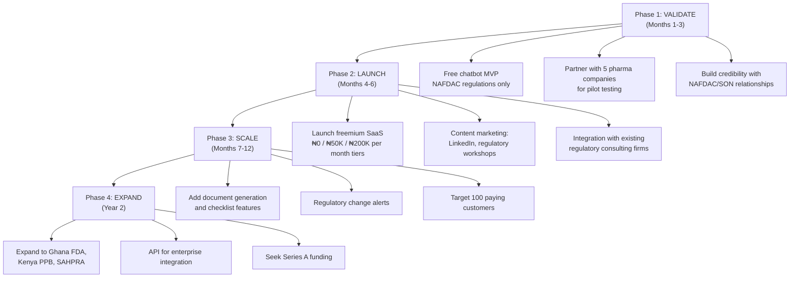
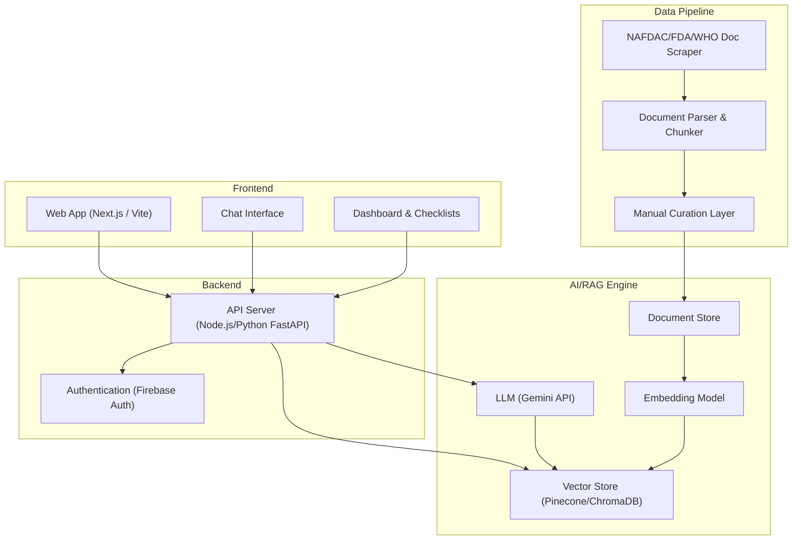

# MedIntel AI — Product Scrutiny, Market Viability & Implementation Roadmap

## 1. Executive Summary

You want to build a **RAG-based AI regulatory assistant** for the healthcare/pharma/medtech space. Before writing a single line of code, this document answers the hard questions: *Is this worth building? Can it sell? What needs to change to make it a real product?*

**Bottom line:** The core idea is **highly relevant**, but the original framing has critical weaknesses that will kill it in market. Below, I reframe the product into something that is not just a project — but a **fundable, marketable, defensible product** for the Nigerian and African regulatory landscape.

---

## 2. Market Relevance Analysis

### 2.1 The Problem Is Real and Painful

| Pain Point | Evidence |
|---|---|
| **Regulatory fragmentation** | Nigeria alone has NAFDAC, SON, MDCN, PCN — each with different rules. Add WHO, FDA, EU MDR for export-focused manufacturers |
| **Documentation failures** | Incomplete dossiers are the **#1 cause** of NAFDAC registration delays — manufacturers simply don't know what's required |
| **No dedicated framework until 2025** | Nigeria's first consolidated medical device regulation only dropped in 2025. Most manufacturers are still scrambling to understand it |
| **AI/SaMD regulatory vacuum** | No specific classification criteria for AI-powered medical devices in Nigeria. Companies have zero guidance |
| **Skilled personnel shortage** | Critical lack of regulatory affairs professionals across Africa — companies can't hire their way out of compliance |

> [!IMPORTANT]
> **The #1 reason medical device and drug registrations fail in Nigeria is NOT bad products — it's bad paperwork.** Manufacturers don't know the rules, can't find the right forms, and submit incomplete dossiers. This is a **$580M+ market** (medical devices alone) with an information bottleneck.

### 2.2 Global Market Size

| Segment | 2025 Value | CAGR |
|---|---|---|
| Healthcare Compliance Software | $3.6B–$3.9B | 11–14% |
| AI in Regulatory Affairs | $1.0B–$2.0B | ~10% |
| AI Governance & Compliance | $2.2B | ~15.8% |
| Nigeria Medical Device Market | $580M | Growing to $632M by 2030 |
| Nigeria Digital Health Market | $1.3B | Rapid growth |

### 2.3 Existing Competitors (Global)

| Competitor | Focus | Gap for Nigeria |
|---|---|---|
| **Raiana** (ChatMDR, ChatFDA) | EU MDR, FDA regulations | ❌ Zero NAFDAC/African coverage |
| **Freyr (freya chatbot)** | Global regulatory database | ❌ Minimal Africa-specific data |
| **Mantra Systems** | EU MDR documentation | ❌ Europe-only |
| **Redica Systems** | FDA inspection intelligence | ❌ US-centric |
| **Zelthy** | GxP documentation | ❌ Enterprise-only, expensive |

> [!TIP]
> **The critical gap:** Every existing competitor is built for US/EU markets. There is **NO AI-powered regulatory intelligence tool purpose-built for NAFDAC, the Nigerian, or broader African regulatory landscape.** This is your moat.

---

## 3. Honest Assessment — What's Wrong with "MedIntel AI" As-Is

### 3.1 Shortcomings That Would Kill the Product

| Issue | Why It's Fatal |
|---|---|
| **Generic positioning** | "Medical ethics and regulatory assistant" is too vague. It sounds like a school project, not a product. Nobody searches for "medical ethics chatbot" |
| **"Ethics" is the wrong anchor** | Ethics is subjective, varies by culture, and is not an operational pain point. Manufacturers don't wake up asking "is this ethical?" — they ask "**will NAFDAC approve this?**" |
| **No regulatory specificity** | A chatbot that knows "everything about medical regulation globally" will know nothing deeply. It'll hallucinate on specifics |
| **No clear buyer** | Who pays? A startup founder? A regulatory affairs manager? A hospital? The target is too broad |
| **RAG alone won't cut it** | A chatbot that just answers questions is a feature, not a product. You need workflow integration — checklists, document generation, submission tracking |
| **Trust problem** | In regulated industries, wrong answers can cost millions in delays or legal liability. A generic AI chatbot will not be trusted without citations, source verification, and validation |

### 3.2 What Happens If You Don't Fix These

You build a chatbot → You demo it → People say "cool" → Nobody pays for it → It joins thousands of abandoned AI projects on GitHub.

---

## 4. The Rebrand — From Project to Product

### 4.1 New Product Identity

> **MedIntel AI** → Rebranded as: **MedIntel — The Regulatory Intelligence Platform for African Healthcare**

The name "MedIntel" is actually strong — keep it. But the positioning changes completely:

| Attribute | Before (Weak) | After (Strong) |
|---|---|---|
| **Tagline** | "Medical ethics and regulatory assistant" | **"Navigate NAFDAC. Ship Compliant. Go to Market Faster."** |
| **Core promise** | Answer questions about medical ethics | **Cut your NAFDAC registration timeline by 60%** |
| **Target user** | Anyone in healthcare | **Regulatory affairs managers, founders, and clinical engineers at medical device & pharma companies operating in Nigeria** |
| **Differentiator** | AI chatbot | **The only AI platform purpose-built for Nigerian/African medical device & drug regulatory compliance** |
| **Revenue model** | None defined | **SaaS tiers: Free (chatbot) → Pro (checklists + document generation) → Enterprise (submission tracking + consulting integration)** |

### 4.2 Product Pillars (Not Just a Chatbot)

```
┌─────────────────────────────────────────────────────────┐
│                    MedIntel Platform                     │
├─────────────┬──────────────┬──────────────┬─────────────┤
│  🤖 Intel   │ 📋 Comply    │ 📄 Draft     │ 🔔 Watch    │
│  Chat       │  Checklists  │  Documents   │  Alerts     │
├─────────────┼──────────────┼──────────────┼─────────────┤
│ RAG-powered │ Step-by-step │ Auto-generate│ Real-time   │
│ Q&A on      │ compliance   │ regulatory   │ regulatory  │
│ NAFDAC,     │ workflows    │ submission   │ change      │
│ SON, WHO,   │ for device   │ templates    │ monitoring  │
│ FDA, EU MDR │ classes &    │ (cover       │ (NAFDAC     │
│ regulations │ drug types   │ letters,     │ directives, │
│             │              │ dossier      │ guideline   │
│             │              │ outlines)    │ updates)    │
└─────────────┴──────────────┴──────────────┴─────────────┘
```

### 4.3 Why This Version Is Marketable

1. **Specific pain = specific buyer.** "Cut your NAFDAC registration time" is a message that resonates with every pharma/medtech company in Nigeria
2. **No competition in this niche.** Raiana, Freyr, Zelthy — none of them touch NAFDAC. You own the space
3. **Government alignment.** Nigeria's Health Sector Renewal Initiative (2025-2030) is pushing local manufacturing. More manufacturers = more compliance needs = more customers
4. **Scalable across Africa.** Start with NAFDAC → expand to Ghana FDA, Kenya PPB, South Africa SAHPRA, Tanzania TMDA. Pan-African regulatory intelligence
5. **Fundable story.** "We're the Bloomberg Terminal for African healthcare regulation" — VCs understand this

---

## 5. Marketability in Nigeria

### 5.1 Target Customers (Ranked by Willingness to Pay)

| Segment | Size in Nigeria | Pain Level | Ability to Pay |
|---|---|---|---|
| **Pharmaceutical manufacturers** | 150+ licensed companies | 🔴 Critical — dossier rejections cost months | 💰💰💰 High |
| **Medical device importers/distributors** | 500+ companies | 🔴 New 2025 regulations creating panic | 💰💰 Medium-High |
| **Local device manufacturers** | 50+ (growing with govt incentives) | 🔴 No in-house regulatory expertise | 💰💰 Medium |
| **Regulatory consultancies** | 30+ firms | 🟡 Need efficiency tools | 💰💰💰 High |
| **Clinical research organizations (CROs)** | 20+ | 🟡 Ethics committee navigation | 💰💰 Medium |
| **Healthtech startups (SaMD)** | 100+ | 🔴 No regulatory pathway clarity for AI/software devices | 💰 Low-Medium |

### 5.2 Go-to-Market Strategy for Nigeria



### 5.3 Pricing Strategy (Nigeria-Optimized)

| Tier | Price (Monthly) | Features |
|---|---|---|
| **Free** | ₦0 | 10 chatbot queries/day, basic NAFDAC info |
| **Professional** | ₦50,000 (~$30) | Unlimited queries, compliance checklists, document templates |
| **Business** | ₦200,000 (~$120) | Everything + regulatory alerts, submission tracking, priority support |
| **Enterprise** | Custom | API access, custom integrations, dedicated account manager |

---

## 6. Risk Assessment

### 6.1 Critical Risks & Mitigations

| Risk | Severity | Mitigation |
|---|---|---|
| **AI hallucination on regulatory requirements** | 🔴 Critical — wrong guidance could cause legal/financial harm | Mandatory source citations on every response. "Human-in-the-loop" disclaimer. RAG grounded ONLY in verified documents |
| **Regulatory data sourcing** | 🔴 Critical — NAFDAC doesn't have a clean API or structured database | Manual curation + web scraping of NAFDAC Regulatory Directives (RDs). Partner with regulatory consultants for validation |
| **Liability** | 🟡 High — if someone follows MedIntel's advice and gets rejected, who's responsible? | Clear Terms of Service: "For informational purposes only. Not a substitute for professional regulatory advice." Insurance. |
| **Trust adoption** | 🟡 Medium — Nigerian enterprises are skeptical of AI tools | Start with consultancies (they validate it), then their clients adopt it |
| **Low willingness to pay** | 🟡 Medium — Nigerian SMEs resist SaaS subscriptions | Freemium model. Show ROI: "Save ₦2M in consulting fees per registration" |

---

## 7. Technical Implementation — How to Build It Efficiently

### 7.1 Architecture Overview



### 7.2 Knowledge Base (The Real Asset)

The RAG system is only as good as its knowledge base. This is the **most critical and time-intensive** part:

| Source | Content | Acquisition Method |
|---|---|---|
| **NAFDAC Regulatory Directives** | Registration guidelines, forms, classification rules | Manual download + PDF parsing from nafdac.gov.ng |
| **Medical Devices Regulations 2025** | New device framework (risk classes, lifecycle requirements) | Official gazette + regulatory consultancy input |
| **NAFDAC Drug Registration Guidelines** | Dossier requirements, CTD format, bioequivalence rules | NAFDAC website + published guidelines |
| **WHO Technical Reports** | GMP guidelines, prequalification requirements | WHO website (well-structured, easier to scrape) |
| **FDA Guidance Documents** | 510(k), PMA, De Novo pathways | FDA.gov (structured, accessible) |
| **EU MDR / IVDR** | CE marking, clinical evaluation, post-market surveillance | EUR-Lex + harmonized standards |
| **ISO Standards Summaries** | ISO 13485, ISO 14971, IEC 62304 | Summaries only (full standards are copyrighted) |
| **Nigeria Drug & Medical Device Laws** | NAFDAC Act, Pharmacy Act, Poisons & Pharmacy Act | Nigerian Law databases |

### 7.3 Technology Stack

| Layer | Technology | Why |
|---|---|---|
| **Frontend** | Vite + React (or plain HTML/CSS/JS for MVP) | Fast, modern, easy to iterate |
| **Backend** | Python (FastAPI) | Best ecosystem for AI/ML, LangChain/LlamaIndex support |
| **LLM** | Google Gemini API | Cost-effective, strong performance, good for RAG |
| **Embeddings** | Gemini Embedding Model | Consistent with LLM choice |
| **Vector DB** | ChromaDB (MVP) → Pinecone (scale) | ChromaDB is free and local; Pinecone for production |
| **Auth** | Firebase Auth | Quick setup, Google sign-in, free tier |
| **Database** | Firebase Firestore | User data, chat history, saved checklists |
| **Hosting** | Vercel (frontend) + Railway/Render (backend) | Affordable, easy deployment |
| **Document Processing** | LangChain + PyMuPDF + Unstructured.io | PDF parsing, chunking, metadata extraction |

### 7.4 MVP Feature Set (Build This First)

> [!IMPORTANT]
> **MVP scope — ship in 4-6 weeks, not 6 months.**

| Feature | Priority | Description |
|---|---|---|
| **Regulatory Chat** | 🔴 P0 | RAG-powered Q&A grounded in NAFDAC, FDA, WHO docs. Every answer includes source citations |
| **NAFDAC Registration Checklist** | 🔴 P0 | Interactive step-by-step guide: "I want to register a Class B medical device in Nigeria" → full checklist |
| **Document Classification Helper** | 🟡 P1 | User describes their product → MedIntel suggests device class (Class A/B/C/D) and regulatory pathway |
| **Regulation Search** | 🟡 P1 | Full-text search across ingested regulatory documents with highlighted results |
| **User Accounts & History** | 🟡 P1 | Save chat history, bookmark checklists, track progress |
| **Regulatory Alerts** | 🟢 P2 | Email notifications when NAFDAC publishes new directives |
| **Document Template Generator** | 🟢 P2 | Auto-generate cover letter / dossier outline for submissions |

### 7.5 Development Timeline

| Phase | Duration | Deliverable |
|---|---|---|
| **Phase 0: Data Collection** | Weeks 1-2 | Curate NAFDAC docs, FDA guidance, WHO reports. Parse, chunk, embed into vector store |
| **Phase 1: RAG Engine** | Weeks 3-4 | Working chat interface with citation-backed responses. Test with real regulatory questions |
| **Phase 2: Checklists & Classification** | Weeks 5-6 | Interactive compliance checklists. Device classification helper |
| **Phase 3: Polish & Auth** | Weeks 7-8 | User accounts, chat history, responsive design, landing page |
| **Phase 4: Beta Launch** | Week 9 | Deploy to production. Onboard 5-10 pilot users (pharma companies, regulatory consultants) |
| **Phase 5: Iterate** | Weeks 10-12 | Incorporate feedback, expand knowledge base, add document templates |

---

## 8. Efficiency Assessment

### 8.1 What Makes This Achievable

| Factor | Assessment |
|---|---|
| **Technical complexity** | ✅ **Moderate.** RAG is a well-understood pattern. LangChain/LlamaIndex have mature tooling |
| **Data availability** | ⚠️ **Challenging but doable.** NAFDAC publishes PDFs. FDA/WHO have structured data. Main effort is curation |
| **Solo developer feasibility** | ✅ **Yes for MVP.** One developer can ship a functional chatbot + checklists in 6-8 weeks |
| **Cost to build MVP** | ✅ **Low.** ~$50-100/month for Gemini API + hosting. ChromaDB is free. Firebase free tier is generous |
| **Cost to scale** | ⚠️ **Moderate.** At 1,000+ users, API costs scale. Plan for Pinecone + higher Gemini tier |

### 8.2 What Would Make It Fail

1. **Trying to boil the ocean** — covering every global regulation from day one. Start with NAFDAC only.
2. **Skipping data curation** — garbage in, garbage out. Spending 2 weeks on data quality is the best investment.
3. **No real user feedback** — build with 3-5 regulatory affairs professionals from day one, not in isolation.
4. **Treating it as a side project** — this needs dedicated focus for the 8-week sprint.

---

## 9. Revenue Projection (Conservative, Year 1 Nigeria Only)

| Metric | Value |
|---|---|
| Addressable companies in Nigeria | ~700 (pharma + device + importers) |
| Realistic Year 1 conversion | 2-5% = **15-35 paying customers** |
| Average revenue per customer (Pro tier) | ₦50,000/month = ₦600,000/year |
| **Year 1 revenue estimate** | **₦9M–₦21M ($5,400–$12,600)** |
| Year 2 (with enterprise + expansion) | **₦50M–₦100M ($30K–$60K)** |

> [!NOTE]
> This is a realistic bootstrapped projection. With VC funding and an aggressive sales team, these numbers could be 5-10x higher. The real play is becoming the **standard regulatory intelligence tool for Africa**, at which point the TAM is in the hundreds of millions.

---

## 10. Competitive Moat Summary

```
🏆 Why MedIntel wins in Nigeria/Africa:

1. FIRST MOVER — No competitor covers NAFDAC/African regulations
2. LOCAL CONTEXT — Built by Nigerians, for Nigerian regulatory reality
3. DATA MOAT — Curated NAFDAC knowledge base is hard to replicate
4. TRUST — Partnerships with regulatory consultants = credibility
5. EXPANSION — Nigeria → West Africa → Pan-African = massive TAM
```

---

## 11. Open Questions for You

Before we start building, I need your decisions on:

> [!IMPORTANT]
> **Please respond to these before I begin implementation:**

1. **Scope confirmation:** Do you agree with the rebranded positioning (NAFDAC-first, not "global medical ethics")? Or do you want a different focus?

2. **Tech stack preference:** Are you comfortable with **Python (FastAPI) backend + Vite/React frontend + Gemini API**? Or do you prefer a different stack?

3. **MVP scope:** Should I build the full web platform (chat + checklists + auth), or start with a simpler single-page chatbot first?

4. **Data sourcing:** Do you have access to any NAFDAC documents, regulatory guidelines, or industry contacts who can help validate the knowledge base? Or should I plan to source everything from public websites?

5. **Deployment target:** Where do you want this hosted? (Vercel + Railway? Firebase? Something else?)

6. **Timeline:** Are you targeting the 6-8 week sprint, or is this a more relaxed timeline?

---

## Verification Plan

### Automated Tests
- Unit tests for RAG pipeline (retrieval accuracy, citation extraction)
- Integration tests for API endpoints
- End-to-end tests for chat flow

### Manual Verification
- Test with real NAFDAC regulatory questions (validated by domain experts)
- UI/UX review with target users
- Performance testing (response latency < 3 seconds)
